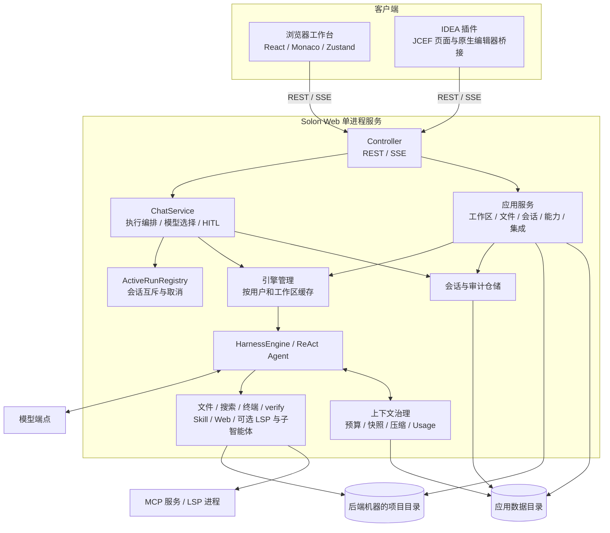

# UData Harness 系统架构

UData Harness 是单体 Solon Web 应用。前端使用 React、Vite、Zustand 和 Monaco Editor，构建产物输出到 `src/main/resources/static`，与后端一起打包为 JAR。网页与 IDEA 插件共用后端，工具在后端机器执行。



图中工具受配置与权限控制，并非全部默认启用。详细模块职责、数据模型、时序图与故障边界见[系统设计文档](design.md)。

## 用户与会话隔离

每个请求都携带 `X-User-Id`。合法 ID 由字母、数字、`.`、`_` 或 `-` 组成，最长 64 个字符。服务端据此解析：

```text
<已注册的本地目录>                                  当前生效的智能体工作目录
<agent.workspace>/<userId>/                          兜底工作目录
<agent.data-dir>/users/<userId>/sessions/...         持久化会话
<agent.data-dir>/workspaces/<userId>/...             工作区注册表
```

浏览器从不直接访问本地文件系统。它向后端请求所有可用的文件系统根目录，并按需逐级列出目录（每次一层）。目录必须先注册才能成为智能体工作目录。会话持久化对应的 `workspaceId`；引擎按 `userId:workspaceId` 缓存，执行时从会话元数据解析工作目录。`X-Workspace-Id` 为单个请求选择工作区，不会改变其他客户端的默认选择；不带该请求头时使用用户的默认工作区。

路径会被规范化，必须位于用户根目录之下，文件 API 会拒绝符号链接。超过 2 MB 的文件不提供打开或保存。
## 智能体运行与人机协同（HITL）

每个会话同时只允许一个运行中的任务。`ActiveRunRegistry` 负责取消控制，SSE 负责转发思考、文本、工具生命周期、完成和错误事件。当 Harness 产生待处理的 HITL 任务时，事件流会发送一个 `hitl` 事件并暂停。`/api/hitl/decide` 提交同意/跳过/拒绝后，同一个 `FileAgentSession` 恢复执行，ReAct 状态得以保留。

## MCP

MCP 集成定义在启动时加载进每个用户的 `HarnessEngine`，并可在运行时修改。它们是服务级的，而非按用户隔离。原始请求头/环境变量值持久化在 `<agent.data-dir>/integrations` 下，列表接口返回时会脱敏这些值。

## Skill 与子智能体

启用后，主智能体会暴露 Harness 的 `skillread`/`skillrefresh` 和 `task`/`multitask` 工具；这些可选的委派工具默认关闭。每个用户/工作区对应一个按需创建的 `HarnessEngine`。后端 Skill 库与激活副本的路径为：

```text
<agent.data-dir>/skill-library/<name>/             受管的包
<所选工作区>/.soloncode/skills/<name>/             激活的副本
```

包内可包含 `SKILL.md`、脚本、参考资料和资源文件。ZIP 导入会检查条目数量、解压后大小和路径越界。激活 Skill 会复制完整包，且只刷新该用户的挂载和按需加载的主智能体；停用只删除该用户的副本；删除库中的包不会悄然改动已激活的副本。

Harness 内置智能体保持可用。自定义子智能体 Markdown 文件位于 `<agent.data-dir>/capabilities/agents`，目前在所有用户引擎间共享。

## 安全边界

Harness 沙盒模式与系统限制已启用，禁止访问用户主目录。`X-User-Id` 是隔离选择器，不是认证手段。生产环境网关必须负责：认证用户并覆盖该请求头、对全局集成变更做鉴权、增加审计日志与限流、保护数据目录和模型提供商密钥。
