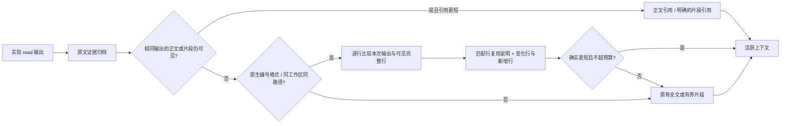

# 第三批升级：范围复用、需求修订和长任务验收

日期：2026-10-01。本批已实现三项改造，全量 97 项测试通过。所有模型响应使用本地模拟；没有访问供应商 API。

## 1. 文件范围复用

工具仍实际读文件，原始输出先归档，再决定模型看到多少重复内容。复用依据是本次返回的内容，不是路径缓存。



例如 A.java 先读取 100–200 行，再读取 150–250 行。
若 150–200 行在上下文中仍可见且逐行一致，第二次结果以 `[reused visible lines 150-200]` 代替重复代码，只展示 201–250 行及原有读取头尾。
若第 175 行已修改，该行仍展示新内容，复用段在它之前和之后分开。

范围识别适配当前 Solon TerminalTalent 的 `file_path/offset/limit` 输出：文件头和 `行号 | 正文`。
不同工作区、不同路径、已退出的证据、引用链、省略的中间行和单行截断文本均不能作为可读代码来复用。
长片段在可能时按完整行截取。未知格式或增量结果不够短，沿用原投影。

这只证明当前读到的某些行与可见文本一致，不能证明整个文件版本相同。不会跳过磁盘读取，也尚未增加符号级读取工具。
投影元数据新增 `range_delta`；原文仍用证据 ID 恢复。

## 2. 有来源的需求修订

普通 `task_state_update` 保留既有保护规则。修改目标、替换约束或验收条件使用新工具：

```json
{
  "expectedRevision": 3,
  "source_quote": "Allow API rename to newCalc and update B",
  "reason": "用户允许 API 改名并要求同步更新 B",
  "patch": {
    "objective": "Rename A API and update B",
    "constraints": ["Allow newCalc API", "Use JDK8"],
    "acceptance": ["A.newCalc(3) == 4", "B.twice(3) == 8"]
  }
}
```

Agent 先通过 `task_state_get` 获取当前 revision。quote 必须逐字出现在本轮最新用户请求中，长度为 8–2000 字符。
revision 不一致、引用伪造、修改非要求字段或活跃状态超限，均拒绝提交。
patch 中的要求字段整体替换，未提供的字段保留；pending、completed 和 evidence 不由修订工具删除。

旧要求“Keep oldCalc API”被替代后，旧摘要仍可能提到它。
普通 update 不能把这个已淘汰要求重新加入；只有再次显式修订才可恢复。
修订结果直接返回活跃要求和取代旧要求的说明。系统提示指导 Agent 使用最新修订，压缩后状态快照也读取新要求。
未压缩时不逐轮重写旧快照，以保持前缀稳定。

状态存储采用向后兼容的单文件封装：

```text
task-state.json
  formatVersion: 2
  state: 活跃字段 + revision + requirementSources
  history: 修订时间、理由、原文引用、用户消息哈希、字段旧值和新值
```

状态与审计一次原子替换，避免只修改一边。旧格式状态在下一次写入时迁移。
默认读取不加载历史到模型；`task_state_get(includeHistory=true, historyLimit=5)` 返回独立的有界预览。
完整审计保存在磁盘，预览会明确标注截断。单进程多实例共享写锁和版本检查，不提供多进程并发事务。

`requirementSources` 区分 `agent_maintained` 与 `user_quote`，表示字段最近更新的来源。
逐字引用匹配不是语义授权证明，也不保证模型正确理解了变更范围；目前未逐条建模约束来源。
完成声明依然由 Agent 维护，不能代替独立验收。

## 3. 长任务评测

新增 `LongTaskEvaluationTest`，模型动作由脚本驱动，但文件读写、Java 编译和运行验收是真实执行。
独立验收检查 A 的当前方法以及 `B.twice(3) == 8`，不依赖最终回答或状态中的 completed。

| 阶段 | 当前代码 | 实际验收 |
| --- | --- | --- |
| 初始 | B 错误地直接返回 x * 2 | 失败 |
| 第一阶段修复 | B 使用 A.oldCalc | 通过旧 API 验收 |
| 用户允许改名，A 改成 newCalc | B 仍调用 oldCalc | 编译失败；旧通过记录失效 |
| B 同步更新 | B 使用 A.newCalc | 新 API 验收通过 |
| 交付检查 | 在 Agent 工具之外重新编译并验收 | 通过 |

完整场景跨 A → B → A、4 次阶段检查点和会话重启，包含错误约束重新加入的拒绝、证据搜索和恢复。
测试输出绑定当前 A/B 源码哈希，评测比较旧通过证据与当前代码，避免把历史通过当作当前通过。
此哈希绑定属于评测夹具；生产环境尚未普遍自动绑定测试结果与工作区版本。

负向用例故意让 Agent 回答“All tests passed”，状态也声称完成；独立验收仍判定失败。
另一负向检查证明旧 API 的代码即使通过旧验收，在需求改成新 API 后也不能通过新验收。

本次回放：56 次模型请求、4 次摘要策略执行、39 次实际文件/编译/诊断工具执行。
上下文工具由拦截器接管，39 次不包含这些状态/检索/检查点调用；具体事件计数见报告。
摘要也是脚本结果，未产生真实摘要 API 调用。模型未提供 usage，报告将其保留为未知，不当作零成本。

```powershell
.\mvn8.ps1 test
.\mvn8.ps1 '-Dtest=LongTaskEvaluationTest,ReadRangeReuseTest,TaskStateRevisionTest' test
```

产物：`target/context-long-task-evaluation.json` 和 `target/context-management-comparison.json`。
后者的新版本载荷对照从 1,033,848 字符降到 88,584 字符，约减少 91.4%；新修订工具增加了固定 schema 开销。

这些结果证明生命周期、状态和独立验收链路可运行，不能证明真实模型自主完成长任务的能力提高，也不证明真实 Token、缓存、费用收益或优于 Claude Code。
下一步应把回放替换为相同模型参数的真实动作生成，保持同一验收夹具，重复运行并对齐全部 API 账单。

## 4. 实现入口

- [文件范围复用](D:/code/udataHarness/src/main/java/com/udata/harness/common/context/ReadRangeReuse.java)
- [工具投影接入](D:/code/udataHarness/src/main/java/com/udata/harness/common/context/ToolResultPolicy.java)
- [状态修订与原子审计](D:/code/udataHarness/src/main/java/com/udata/harness/common/context/TaskStateStore.java)
- [工具定义](D:/code/udataHarness/src/main/java/com/udata/harness/common/context/ContextTools.java)
- [实际 Agent 长任务评测](D:/code/udataHarness/src/test/java/com/udata/harness/common/context/LongTaskEvaluationTest.java)
- [范围复用边界测试](D:/code/udataHarness/src/test/java/com/udata/harness/common/context/ReadRangeReuseTest.java)
- [修订与并发测试](D:/code/udataHarness/src/test/java/com/udata/harness/common/context/TaskStateRevisionTest.java)
