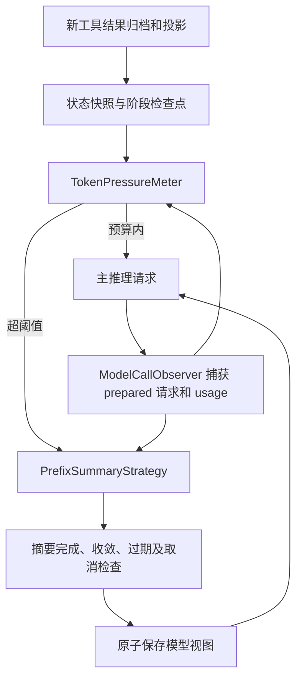

# 第四批改造：摘要前缀复用、统一 Token 压力、提交检查

日期：2026-10-08。范围：启用 `agent.context.management-enabled` 的主 Agent 文件会话。子 Agent 和关闭治理开关的路径保留原框架策略。

## 变化与架构



生产入口在 `UserHarnessEngineServiceImpl`：治理开启时使用 `PrefixSummaryStrategy`。`PersistentContextCompressionInterceptor` 将主会话的预算路径交给 `BudgetContextCompactor`，阶段检查点仍由 `ContextPlanner` 执行。两个入口共用摘要策略和提交检查，完整归档不随摘要删除。

## 1. 摘要复用会话前缀

以前框架将历史转成摘要专用 userData，并使用另一套 system。现在摘要输入使用实际历史消息，保持角色、工具调用参数和顺序：

```text
先前已发送请求的 prepared system 消息
先前已发送请求的有效 tools 定义
按时间排列的历史前缀（包括此范围中的受保护用户原文和状态快照）
追加一条“生成继续任务所需摘要”的 user 指令
```

摘要指令包含需求修订、决策、来源、文件位置、证据 ID、验证范围、未解决问题和下一步。最新用户原文与任务状态仍独立保留，不依赖摘要来保存。

仅当模型路由、原始 system、工具 schema、参数和 CacheControl 的签名一致，且上一次 prepared 请求的历史与对应工作记忆一致，才复用捕获的 system/tools。没有合格记录时，使用当前 system 和工具定义构造消息请求，记录 `preparedHeaderReused=false`。首次请求、重启或请求头变化都可能走这条回退路径。

摘要保持工具定义，但关闭自动工具执行，并设置 `tool_choice=none`。修改局限于本次请求的选项与 final prompt，不改共享模型配置。当前 Solon 的工具集合是只读视图，摘要使用独立 `SummaryOptions` 副本替换工具定义；通过框架公开的 options 重置接口安装此副本。

例如此前主请求是 `S + tools + M1…M20`，摘要输入是 `S + tools + M1…M12 + 摘要指令`，前面的消息可以对齐。如果压缩前新增了状态快照，匹配可能只剩 system/tools。因此同时记录实际可比较的 `commonMessagePrefix`，不会把摘要输入长度全部计为复用。

这是**结构上的缓存机会**。供应商序列化、参数、缓存 TTL 等都会影响真实 Cache Read；摘要替换历史后，后续主请求仍可能重建消息缓存。真实读写量继续读取 `providerUsageByModelAndPurpose`，不从结构匹配推算命中率。

## 2. 统一 Token 压力

同一个会话级 `TokenPressureMeter` 负责触发、尾部保留、候选结果和最终提交预算的计量。记录 system、消息、工具定义，以及请求准备余量；文本正文只计算一次，工具参数、Thinking 和媒体单独计入，使用框架 tokenizer。不会将持久化 JSON 中重复保存的 content、TextBlock 和内部时间戳全部当作输入。它是启发式估算，不是供应商精确 tokenizer，也没有多模态定价器。

上一次成功主推理的 usage 可用且请求头一致时：

```text
校准输入 = 上次供应商输入 Token + 当前本地估算 − 上次本地估算
本次压力 = max(校准输入, 当前本地估算 + 准备余量)
```

输出消息和新工具结果进入当前工作记忆后，自然作为增量计入。供应商输出 Token 不直接再累加，避免和新增 assistant 消息重复计数。失败调用、非终态、无 usage、模型切换和会话清空不提供有效校准；摘要调用不会覆盖主推理锚点。锚点仅在内存中，重启回退为估算。

- OpenAI/DeepSeek 的 prompt Token 已包含缓存命中部分，不再重复加 Cache Read。
- Anthropic 原始 `input_tokens` 不包含缓存部分，但本项目的 Solon 4.1 `AnthropicResponseParser` 已将 Cache Read 与 Cache Creation 合并进 `AiUsage.promptTokens`，Harness 不再加一次。这些 Token 即使计费较低，仍占上下文。
- 未知 usage 不作零消耗处理。小于本地估算的供应商值不能降低安全下限。

阈值由模型窗口、比例和输出预留共同确定：

```text
threshold = min(window × compressionRatio, window − reservedOutput − headroom)
```

输出预留取有效 `max_completion_tokens`、`max_tokens`、`max_output_tokens`；同时存在时保守取最大值。未配置时，Anthropic 沿用本地方言默认 32000；其他路由采用有界估算值，不能据此宣称已知道供应商隐式输出上限。headroom 为窗口的 5%，限制在 64…2000 Token。消息数仍是辅助守卫，默认超过 1000 × 2 条触发。

例如窗口 20000、比例 0.75、输出预留 8000、headroom 1000，阈值是 `min(15000,11000)=11000`，不能等到输入 15000 才压缩。

预算压缩保留按 Token 定价的近期尾部（最多 20 条且不超过配置消息上限，工具组边界可能增加实际条数），通常以阈值的 80% 为提交目标，留出增长空间。服务端上下文超限重试使用更紧目标。候选不足以达标时扩大到所有可摘要历史并有限重试；受保护内容本身过大时显式失败，不静默丢弃请求或工具结果。

## 3. 摘要提交检查

生产摘要只接受成功终态、正常完成原因、非空纯文本；拒绝 `length`、`max_tokens`、`max-tokens`、过滤、工具调用、错误及媒体摘要。最多输出 4096 Token；保留已有供应商输出参数的键，同步限制所有已有输出上限字段。不通过截断正文把不完整摘要伪装成成功。

提交前检查：

1. 包含 `<compacted-summary>` 包装的摘要，必须比被替换消息小。
2. 候选完整模型上下文必须收敛；预算入口还必须满足统一计量的目标预算，刷新任务快照后再次检查。
3. 保留的工具调用和结果必须完整配对。
4. 摘要期间工作记忆正文、会话视图修订号、归档消息数和任务状态 revision 未改变。
5. 线程未中断，流式订阅未取消。
6. 原子写盘成功后，才替换工作记忆并增加压缩代次。

生成过程中不修改活跃工作记忆。比如摘要期间又追加了用户要求，旧摘要被拒绝，后来追加的消息保留；不会用旧快照回滚覆盖它。写盘失败则保留此前模型视图。会话视图的修订检查与保存使用同一实例的同步锁，但**没有跨进程或不同会话实例的磁盘 CAS**。

这些检查证明结构与提交条件有效，不证明自然语言摘要没有遗漏或误述。

## 指标与验证

`metrics.ndjson` 增加 `context_pressure`、`summary_prefix` 和 `summary_rejected`。`context_metrics` 与会话 HTTP 报告展示 `lastContextPressure`、`lastSummaryPrefix`；前者区分 `estimated` / `usage_calibrated`，后者展示 prepared header 是否复用及结构匹配长度。指标不包含提示词正文。

```powershell
.\mvn8.ps1 test '-Dtest=CacheAwareContextTest'
.\mvn8.ps1 test
```

新增测试覆盖 prepared system/tools/历史前缀一致、缓存 Token 口径、usage 增量、参数与路由变化、未知用量、输出预留、截断与膨胀摘要、过期提交、取消、清空会话后的迟到响应，以及生产摘要策略的真实 ReAct 循环。

验证结果：新增 **12 项**测试通过，全量 **109 项**测试通过，0 失败、0 错误。

后续缓存诊断修复了真实流式链只收到 `STEP_END` 的观测遗漏和重复文本估算；当前全量 **112 项**通过。使用本地 HTTP SSE 服务跑实际 Solon 解析链，确认缓存 Token 记录、压力校准与 prepared 前缀捕获有效。详见 [缓存诊断记录](cache-diagnosis-2026-10-08.md)。

还使用本地真实 Anthropic 方言解析响应 JSON，验证 `1000 input + 1000 cache creation + 2000 cache read = 4000 promptTokens`，并验证请求 JSON 的隐式 `max_tokens=32000`。这一依赖契约检查用于防止按原始协议口径重复累加框架已归一化的数据。

ReAct 回放执行 25 次真实工具处理和 26 次主推理组装，期间预算摘要后继续运行，验证用户原文、工具组、原始归档、重启视图及 reason/summary 用量分桶。模型响应由脚本提供，未调用外部模型服务。

本轮不提供真实 Cache Read 提升、人民币费用降低或任务质量提高的结论。接下来应使用相同模型与参数的真实长任务对照，包含摘要及重试账单，并用独立验收测试评估质量。

## 当前取舍

- 本次不升级跨会话检索、向量记忆或文件写入版本检查。
- 若已超服务端窗口，保留原始前缀的摘要请求本身也可能超限；当前会显式拒绝并保留原上下文，没有实现分块摘要兜底。
- 动态 Talent / ChatInterceptor 可能改变实际请求；prepared 记录及保守估算只能改善对齐与压力判断，不能保证每次供应商缓存命中。
- 子 Agent 和关闭治理开关的路径仍由原框架计量，统一入口目前只覆盖启用治理的主会话。
