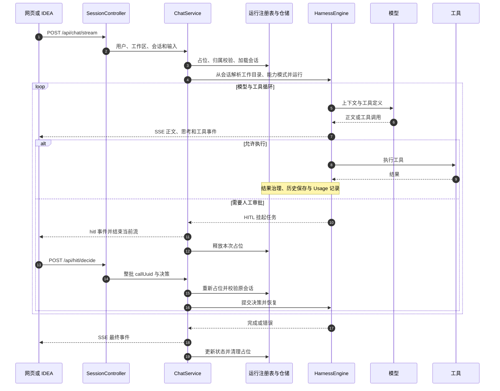
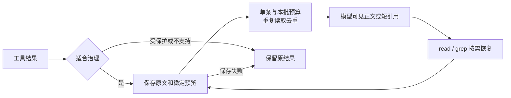

# UData Harness 系统设计

更新日期：2026-10-18

## 1 目标与范围

UData Harness 为本地代码项目提供可持续对话的 AI 执行环境。用户在网页或 IntelliJ IDEA 中提交任务，智能体通过模型和工具循环完成代码阅读、修改、命令执行与验证。后端集中管理工作区、会话、权限、扩展能力及上下文，两个客户端可以访问同一项目和会话。

当前采用单进程、文件持久化部署，适合本机及可信环境。重点是执行过程可观察、工作区归属明确、工具操作可审批，以及长会话的上下文可控。[整体架构图](architecture.md)展示了系统组件及依赖。

| 状态 | 能力 |
|---|---|
| 已实现 | React 工作台、IDEA 接入、工作区注册、文件会话、SSE、HITL、工具加固、结果归档和上下文观察 |
| 可配置启用 | LSP 工具、task/multitask、异步 Bash、Todo、图表及当前时间工具；具体默认值见工具开关配置 |
| 未形成应用入口 | README 提到的 Loop/Goal 与 `/api/automations/*`，当前应用 Controller 和前端主界面没有对应实现入口，不作为现有调度子系统 |
| 后续演进 | 登录认证、管理员权限、分布式运行协调、事件回放、补丁审阅与归档自动清理 |

## 2 技术与部署

| 层次 | 实现 |
|---|---|
| 后端 | Solon Framework 4.1.0，提供 IoC、HTTP、静态资源与 SSE |
| 智能体 | Solon AI Harness 4.1.1，提供模型、ReAct、工具、权限和能力挂载 |
| 前端 | React 18、Vite 6、Zustand、Monaco Editor，配合 Markdown 和图表组件 |
| IDE 客户端 | IntelliJ 插件，JCEF 承载共用页面，JS 桥接原生编辑器 |
| 数据 | 本地目录、Properties、JSONL 与框架文件会话 |
| 打包 | Vite 输出到 `src/main/resources/static`，Maven 打包 `target/udata-harness.jar` |

开发时 Vite 在 5173 端口提供页面，并将 `/api` 代理到后端 8080。生产环境由 Solon 同时提供页面和 API。入口 HTML 禁用缓存，带哈希的构建资源继续使用缓存，避免 IDEA 加载过期入口。

README 要求 JDK 17+、Maven 3.9+；POM 的 source/target 设为 Java 8，这不能证明依赖可在 Java 8 运行。后端按 README 的 JDK 17+ 要求准备，插件按插件说明使用 JDK 21。Windows 默认探测 PowerShell 7，可通过 JVM 属性或环境变量显式选择其他终端。

## 3 模块职责

| 模块 | 主要入口 | 职责 |
|---|---|---|
| 启动与配置 | App、ShellBootstrap、HarnessConfiguration | 终端探测、Solon 启动、路径和仓储装配 |
| 对话 | SessionController、ChatServiceImpl | 校验、模型选择、运行编排、审批恢复和 SSE |
| 运行协调 | ActiveRunRegistry | 会话互斥、订阅和取消信号，状态仅存在于当前进程 |
| 引擎 | UserHarnessEngineServiceImpl | 引擎缓存、模型注册、工具替换、沙箱和上下文拦截器装配 |
| 工作区 | UserWorkspaceServiceImpl | 目录浏览、项目注册、默认目录和请求级选择 |
| 文件服务 | WorkspaceFileServiceImpl | 工作台文件树、读写、搜索和路径边界检查 |
| 会话仓储 | SessionRepository、CompactingFileAgentSession | 元数据、历史消息、模型可见视图和检查点装载 |
| 能力 | CapabilityServiceImpl | Skill 包、ZIP 导入、激活与停用、自定义 Agent |
| 集成 | IntegrationServiceImpl | 服务级 MCP/LSP 定义、启动恢复和引擎同步 |
| 上下文 | common/context | 结果预算、快照、投影、压缩、版本及成本决策 |
| 观测 | ContextDashboardService、UsageAuditRepository | 上下文组成、动作、实际 Usage 和估算费用 |
| 事件协议 | StreamEventMapper、ToolCallStreamInterceptor | 隔离框架事件类型与前端 JSON，补充参数增量流 |

`src/main/java/org/noear/solon/ai/talents/cli` 包含本项目定制的工具，例如 BoundedReadTool、BoundedGrepTool、SafeMutationTalent 和 BashCaptureTalent。升级 Solon AI 时，应检查这些工具与框架接口的适配关系。

## 4 用户与工作区

`X-User-Id` 用于用户目录路由及归属校验，允许字母、数字、点、下划线和连字符，最长 64 字符。它不是身份认证。

`X-Workspace-Id` 可选择当前请求的已注册工作区；无头时使用用户默认工作区。IDEA 注册项目时可使用 `activate=false`，避免改变浏览器默认项目。引擎按 `userId:workspaceId:capabilityMode` 缓存，同一工作区内不同能力模式可同时服务于不同会话；切换目录无需丢弃其他工作区引擎。

会话创建时绑定工作区和能力模式。后台执行及审批续跑从会话元数据恢复工作目录与能力模式，不依赖请求线程或后来切换的默认目录。接口校验会话用户与请求工作区归属。

共享 Skill 仓库与自定义 Agent 定义属于服务级资源。激活 Skill 时，完整包复制到当前解析工作区的 `.soloncode/skills/<name>` 并刷新用户能力；引擎从该工作区挂载包。它不是跨工作区自动共享的用户安装目录。删除共享包不会自动删除已激活副本。沙箱偏好则按用户保存，并同步到该用户的缓存引擎。

## 5 数据模型与存储

| 对象 | 关键字段或状态 | 约束 |
|---|---|---|
| WorkspaceMetadata | 工作区标识、目录等注册信息 | 必须属于当前用户注册表 |
| SessionMetadata | sessionId、userId、workspaceId、title、model、capabilityMode、permissionMode、createdAt、updatedAt | active 由运行注册表动态计算；旧记录缺少 capabilityMode 时按 standard 读取 |
| AgentSession | 消息、模型选项、工具和审批状态 | 可重新加载文件历史，不等于任意执行中断都能自动续跑 |
| HITLTask | callUuid、toolName、args、comment | 恢复前整批任务必须给出决策，同名工具通过 callUuid 区分 |
| ContextArtifact | 正文与元数据 | 只读历史快照，按用户、工作区和会话隔离 |
| ContextEpoch | 上下文代次和前缀指纹 | 历史、规则或模型变化时变代 |

```text
<agent.data-dir>/
├── workspaces/<userId>/workspaces.properties
├── users/<userId>/
│   ├── sessions/<sessionId>/
│   │   ├── meta.properties
│   │   ├── compaction-checkpoint.properties
│   │   └── 框架消息及上下文状态文件
│   ├── token-usage.jsonl
│   └── context-artifacts/<workspaceId>/<会话摘要目录>/
│       ├── <id>.txt
│       ├── <id>.properties
│       ├── context-actions.jsonl
│       └── context-observations.jsonl
├── integrations/{mcp,lsp}/
├── skill-library/<name>/
└── capabilities/agents/<name>.md

<已注册项目目录>/.soloncode/skills/<name>/
<agent.workspace>/<userId>/     未选择项目时的默认目录
```

会话保留原始聊天；模型可见的摘要和投影通过检查点装载，不以摘要覆盖原始聊天正文。项目文件与应用数据分别管理。集成定义可能含密钥，应用数据与工具归档需要独立的文件权限和备份策略。

## 6 执行与审批时序



新消息先校验参数并占用会话运行槽位，随后检查用户、工作区归属及待审批任务，保存模型与思考深度选项。执行中，事件映射层输出 session、run_start、thinking、text、tool_start、tool_end、hitl、run_pending、run_end、error 等 JSON 类型，另有工具参数增量事件。

审批恢复使用原 AgentSession，并选择该会话能力模式对应的引擎；整批挂起调用必须全部决策，不能仅按工具名称批准。恢复时过滤挂起前 Reason 的重放，避免重复展示正文。标准权限下 bash 和 verify（仅超级模式提供 verify）配置为询问；full 权限和会话“始终允许”记录会影响审批行为。

停止操作取消 Reactor 订阅和流，统一结束路径清理占位。取消不会撤销已写入磁盘的修改，也不能保证同步压缩调用立即返回。模型重试次数和初始延时可配置，最大尝试次数包含首次请求。

## 7 工具与上下文治理

### 会话能力模式

能力模式是工具可见范围的会话级预设，存入 `SessionMetadata.capabilityMode`，与 `permissionMode`（`standard`/`full` 审批权限）相互独立。三档的后端值、工具集合和模型默认值如下；沙箱与 HITL 审批在三档中都保留。

| 模式 | 后端值 | 默认工具 | 默认模型 |
|---|---|---|---|
| 经济 | `economy` | Harness `pi` 组的 `read/write/edit/bash`，加 `ls` | `agent.modes.economy.model` |
| 标准 | `standard` | 经济档加 `glob/grep` | `agent.modes.standard.model` |
| 超级 | `super` | Harness 完整工具组中已配置且可用的工具，加项目启用的图表工具 | `agent.modes.super.model` |

经济和标准模式会过滤 `pi` 组附带的异步 Bash 工具；自定义 Bash 工具附带的 `verify` 也只在超级模式暴露。`now`、Web、LSP、Skill、Todo、子智能体、MCP 等扩展能力只可能在超级模式中出现，仍受各自的服务级开关、集成配置和运行时可用性约束。应用没有配置 Memory provider，因此即使超级模式使用 Harness 完整工具组，也会排除 `memory`。模式不会自动放行写文件或命令：权限规则、沙箱和审批继续生效。

创建会话时，`POST /api/sessions` 接收可选 `capabilityMode` 和 `model`。未传模式、或读取旧会话时，使用 `standard`；非法模式直接拒绝。未指定模型时，按该档配置的模型别名选择；别名不存在时回退应用默认模型。当前 `model.yml` 预置经济和标准为 `mimo-v2.6-flash`、超级为 `mimo-v2.6-pro`，可通过环境变量覆盖。`GET /api/meta` 的 `modeModels` 返回各档实际可选的默认模型，供创建弹窗展示。显式创建模型及聊天请求的本轮模型仍可覆盖档位默认值。

`POST /api/sessions/capability` 仅在会话空闲、所属工作区当前可用且没有待处理审批时切换模式；切换同时将会话默认模型设为目标档的默认值，并保留聊天历史及审批权限。前端新建会话弹窗可选择档位和模型，聊天页可在空闲时切档，历史列表展示档位；网页与 IDEA 插件共用这些会话数据和接口。引擎在创建时按模式注册工具，聊天和审批续跑均以持久化的模式取对应引擎，无需重启后端即可切换已有会话。

### 文件和终端

经济模式的目录与内容搜索可由同步 bash 完成。比较模式需按任务完成率、总 Token、调用次数和误改率衡量，不能预设成本收益。

读取工具支持分页与多焦点窗口，目录和搜索提供有界结果及续页。修改工具核对已观察文件版本并原子写入；整行修改可用 line_edits，长行局部修改可用字符串片段。工作台文件 API 与 Agent 工具是不同入口，各自检查访问边界。

同步 Bash 流式落盘，展示截断不终止命令；超时、取消及日志捕获不完整会在结果中标明。verify 识别 Maven、Gradle 或 Node 项目，按支持范围生成验证命令并返回状态、诊断和日志路径。

### 结果预算与历史快照



默认单条预算 64,000 字符、本批 256,000 字符、预览 4,000 字符，属于软限制，不能视为 Token 上限。错误、受保护、媒体及不支持的结果有保留规则。Native Tool 模式在 ActionEnd 处理本批预算，文本 Observation 模式支持单条外置，不启用批量治理。

历史通过只读 `@tool-results/<id>.txt` 恢复。标准和超级模式可用 grep 检索当前会话归档；经济模式需已知归档 ID，再用 read 查看。快照不是当前磁盘，修改前须重新确认源文件版本；未变化的同范围读取可以返回短引用。

### 全局压缩与上下文版本

默认 cache-aligned 压缩在容量压力下发起一次摘要请求，尽量重放与前次正式请求一致的公共前缀。摘要成功且更短才保存检查点；下轮组合检查点与后续原文。legacy 模式使用框架压缩路径。

压缩切开当前用户轮次时，摘要必须有非空 Current Turn Intent 章节，较短原始要求另外逐字引用保留。结构校验不能代替语义完整性验证。稳定消息 ID 用于覆盖范围与投影校验；来源不匹配或检查点损坏时回退原文，投影保存失败时不替换活跃视图。

ContextEpoch 在历史重组、模型、端点、规则或工具定义变化时变代。旧代 Usage 仍计入费用，但不作为新视图的成本基线。公共前缀相似不能证明供应商实际缓存命中。

历史方案中的 context_task_update、context_task_snapshot、context_restore、context_search 不再注册给默认 Agent，任务切换驱动的历史改写已停用。存量类与历史方案不代表当前默认执行路径。

## 8 接口分组

业务接口使用 X-User-Id，工作区相关请求可附 X-Workspace-Id。健康检查和静态页面有独立入口；精确请求参数以 Controller 和请求对象为准。

| 路由 | 用途 |
|---|---|
| GET /api/health、GET /api/meta | 连接探测与客户端元信息 |
| /api/sessions、/api/sessions/messages | 创建（可指定能力模式和模型）、列表、删除和历史 |
| /api/sessions/status、/title、/permission、/capability | 会话状态、标题、审批权限和能力模式；后面三项相对 sessions 前缀 |
| POST /api/chat/stream、POST /api/chat/cancel | 提交任务和停止 |
| POST /api/hitl/decide | 批量决策和恢复流 |
| /api/workspaces、/api/workspaces/roots、/children、/activate | 注册、目录浏览和默认目录；后两项相对 workspaces 前缀 |
| /api/files/* | 工作台文件读写与搜索 |
| /api/capabilities/skills、/api/capabilities/agents、/api/capabilities/refresh | Skill、自定义 Agent 与能力刷新 |
| /api/integrations/mcp、/api/integrations/lsp | 服务级集成配置 |
| /api/settings/sandbox | 用户沙箱偏好 |
| GET /api/context/overview、GET /api/usage/audit | 上下文观测与 Usage 审计 |

## 9 IDEA 双客户端

插件在 JCEF 加载后端 IDEA 模式页面，共用聊天、模型、审批与会话组件。原生桥接提供文件或选区引用、引用队列、文件定位与刷新。模型密钥保留在后端，不放进插件设置。

文本引用使用 `@项目相对路径` 或 `@路径#L起始行-L结束行`，也可附编辑器快照。快照与磁盘可能不同，后端工具仍读磁盘。桥接只开放固定方法，并校验文件位于当前项目真实根目录内。

发送前可提示保存未保存文档；任务结束后刷新磁盘，遇未保存内容保留编辑器文本并按需展示 Diff。当前工具直接修改磁盘，不提供修改前逐项补丁批准及原生撤销保证。

实时 SSE 只在发起端展示；另一端轮询状态并刷新历史，也可恢复审批。插件不负责启停后端。关闭 IDEA 项目会释放页面与桥接，服务进程存活不等于活动 SSE 任务必然继续执行。当前没有跨端实时广播和事件回放协议。

## 10 安全与故障边界

| 情况 | 当前处理与限制 |
|---|---|
| 重复发送或并发审批 | 当前进程的会话运行占位拒绝重复执行 |
| 用户或工作区不符 | 校验失败，拒绝串用会话和目录 |
| 归档保存失败 | 保留原结果，不替换为失效引用 |
| 检查点或投影损坏 | 回退原始历史 |
| 服务重启 | 重载文件会话和集成定义，不承诺活动执行自动恢复 |
| 多实例 | 内存锁和引擎缓存不跨进程，不能直接扩容并假定互斥成立 |
| 外部接入 | 可信网关认证并覆写用户头，限制共享配置和能力库的管理权限 |

沙箱默认启用、禁止用户主目录访问并请求系统级限制；实际终端隔离依赖操作系统和沙箱后端。用户关闭沙箱后，系统级限制也不生效，见[系统级沙箱说明](sandbox-system-restrict.md)。工作区注册允许浏览后端磁盘根目录，宿主机进程权限也是实际边界。

## 11 可观测性与验证

上下文观察面板展示组成趋势、逐请求 Usage、动作与决策原因。费用按配置的模型别名单价和已返回 Usage 估算；缺失价格或缓存字段时保留未知，压缩调用单独计入开销。

JSONL 查询仍有顺序扫描成本，工具归档目前没有自动过期清理。长期运行需要规划配额、轮转和索引，返回条数限制不等于磁盘容量限制。

代码变更按影响范围使用已有检查：

```powershell
mvn test
npm.cmd --prefix frontend run check
npm.cmd --prefix frontend run build
node --test frontend/test/ideaReferences.test.js idea-plugin/test/bridge.test.cjs
```

IDEA 插件变更另运行 `idea-plugin/gradlew.bat buildPlugin verifyPluginStructure`，并在真实 IDE 验证 JCEF、选区引用和未保存文件冲突。集成验收覆盖同用户双工作区、跨用户访问、整批审批、取消、重启历史加载、归档失败与检查点回退。

## 12 演进方向

1. 统一认证与管理权限，明确共享 MCP、LSP、Skill 仓库和 Agent 定义的管理角色。
2. 增加归档保留期、磁盘配额、日志轮转与查询索引。
3. 多实例前先外置运行协调，明确任务归属、取消路由及故障恢复。
4. 为双客户端增加事件序号、存储及重放，明确重连与审批幂等行为。
5. 增加补丁审阅和冲突处理；如落地 Loop/Goal，补齐调度器、预算、状态机和应用接口。

## 13 源码与专题索引

- [后端入口](../src/main/java/com/udata/harness/App.java)
- [对话编排](../src/main/java/com/udata/harness/service/impl/ChatServiceImpl.java)
- [引擎装配](../src/main/java/com/udata/harness/service/impl/UserHarnessEngineServiceImpl.java)
- [能力模式取值](../src/main/java/com/udata/harness/common/domain/CapabilityMode.java)
- [会话仓储](../src/main/java/com/udata/harness/repository/SessionRepository.java)
- [上下文实现](../src/main/java/com/udata/harness/common/context)
- [前端入口](../frontend/src/App.jsx)
- [IDEA 集成](idea-integration.md)
- [文件工具加固](core-file-tools-hardening.md)
- [输出与编辑差异](streaming-output-and-edit-diff.md)
